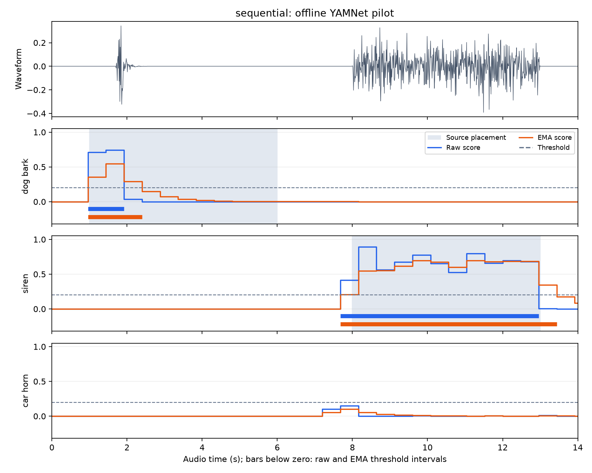
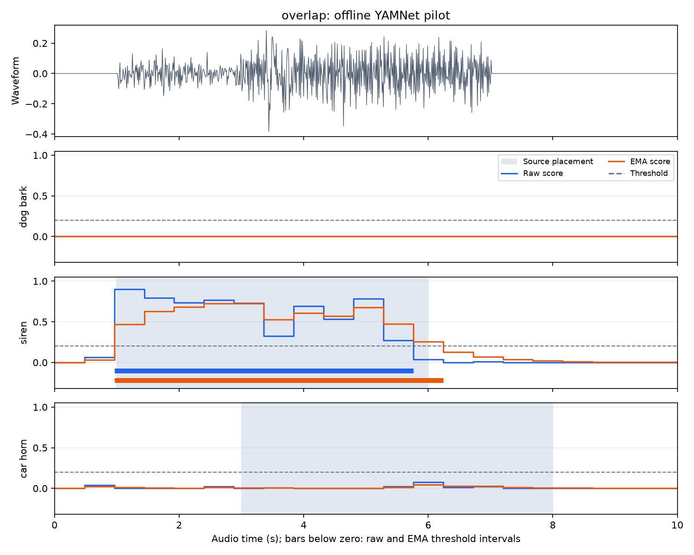
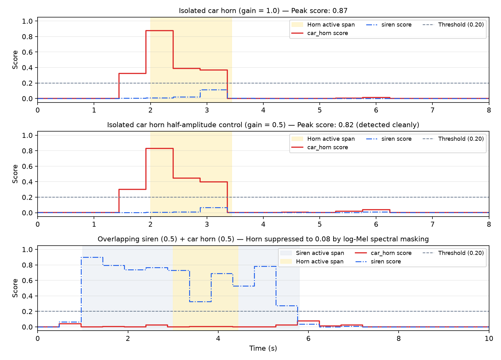
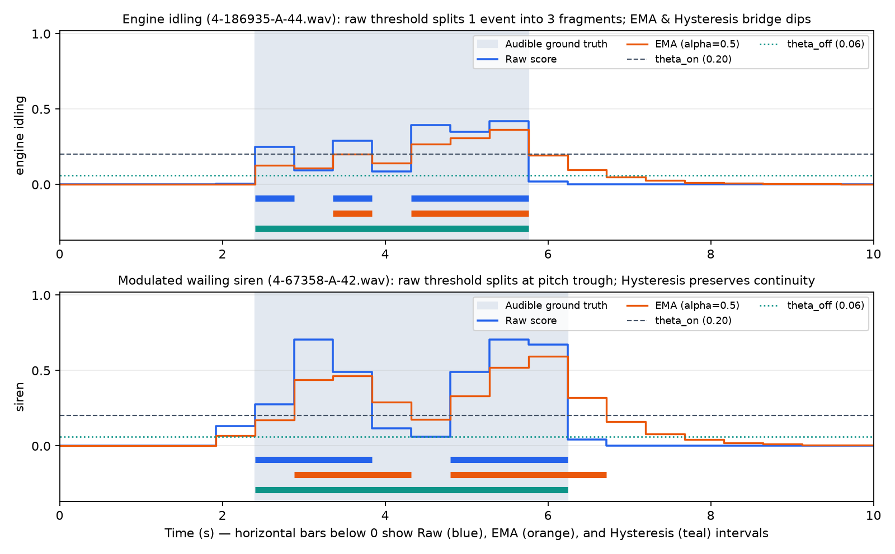
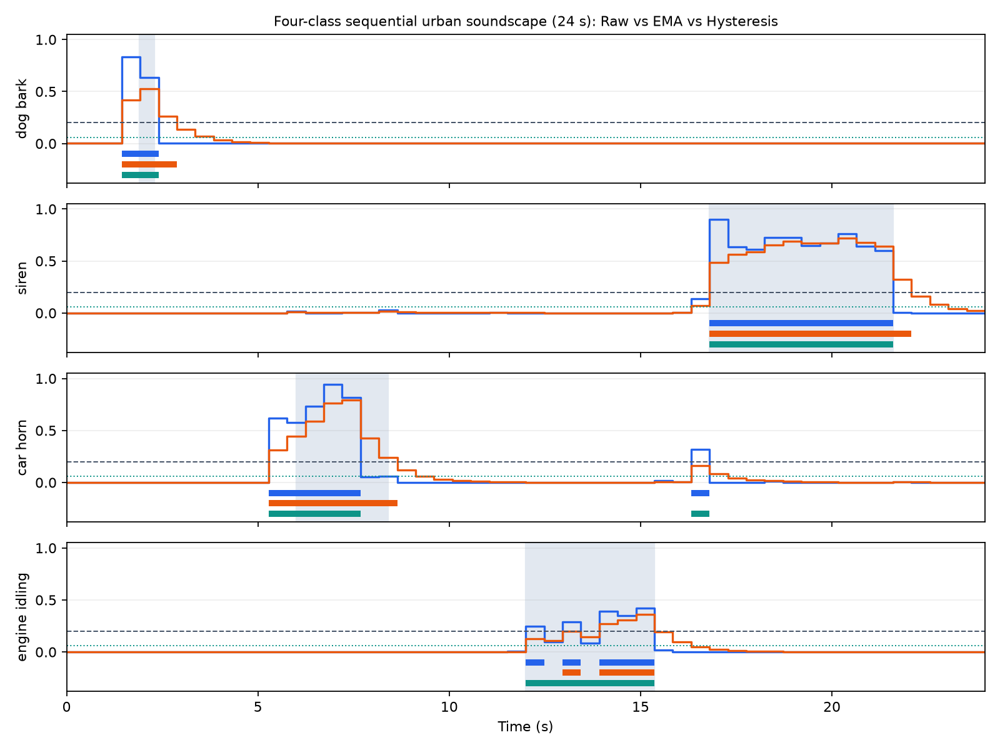

# Urban Sound Event Detection on RK3588 Using Pretrained YAMNet: Taxonomy Alignment, Spectral Masking, and Temporal Postprocessing

**Author:** Mingze Li (Student ID: 550374130)  
**Course:** ELEC5305 Acoustic and Speech Processing, School of Electrical and Computer Engineering, The University of Sydney  
**Supervisor:** Prof. Craig Jin  
**Date:** November 2026  
**Project Website:** <https://kolentossa.github.io/elec5305-project-550374130/>  
**GitHub Repository:** <https://github.com/kolentossa/elec5305-project-550374130>  
**PDF Version:** [ELEC5305_Final_Report_Mingze_Li_550374130.pdf](submission/ELEC5305_Final_Report_Mingze_Li_550374130.pdf)

---

## Abstract

Running sound event detection (SED) on an embedded board requires converting short-time frame or patch scores from a pretrained audio model into stable event start and end times. In this project, I test urban sound event detection on the **Rockchip RK3588 NPU (Embedfire LubanCat-5 V2)** using Google's pretrained **YAMNet** classifier (`0.96 s` patch window, `0.48 s` hop, `64`-band log-Mel spectrogram frontend). Instead of retraining the CNN weights, this work focuses on one research question: *how should patch-level class scores from pretrained YAMNet be mapped across event taxonomies and temporally integrated to balance false alarms, event fragmentation, and onset/offset detection delay on an embedded RK3588 NPU platform?*

I first checked numerical consistency between Windows ONNX CPU, RK3588 ARM64 CPU, and FP16 RKNN NPU execution on `3.0 s` audio windows (`MAE = 1.98e-3`, `15.3 ms` per window on NPU Core 0), and wrote a `2.4 s` sliding-window script that drops the 6th zero-padded patch on each window. In my initial 6-scene pilot (`56 s`, `119` patches), both CPU and NPU gave `100.0%` micro precision and `85.7%` micro recall, but showed three main issues: (1) the `car_horn` score dropped from `0.8765` to `0.0777` when mixed with a `siren`, (2) causal exponential moving average (EMA) smoothing extended interval offsets by `+0.48 s`, and (3) non-stationary classes suffered from mid-event score dips.

In the second experimental iteration (`17` scenes, `178 s` total across separate ESC-50 Fold-3 validation and Fold-4 test sets), I ran controlled tests on both Windows CPU and RK3588 NPU to address each issue: (1) an isolated `-6 dB` half-gain control (`horn_half`) reached a peak NPU score of `0.8296`, confirming that the `0.0777` drop in `overlap` is caused by **spectral masking in the 64-band log-Mel spectrogram** rather than amplitude scaling; (2) grouping parent and child AudioSet engine classes raised `engine_idling` segment recall from `66.7%` to `83.3%` (`Segment F1` from `0.800` to `0.909`) and cut fragmentation in half (`2.67` to `1.33`); and (3) validation-tuned dual-threshold hysteresis (`theta_on = 0.20, theta_off = 0.06`) gave the highest test Segment F1 (`0.864` on RK3588 NPU, `0.878` on CPU) and reduced fragmentation from `1.53` to `1.13` without adding the `+0.47 s` onset delay or `+0.66 s` offset tail seen under heavy causal EMA smoothing (`alpha = 0.3`). Across 87 three-second windows, RK3588 NPU Core 0 averaged `20.83 ms` per `2.4 s` step (`RTF = 0.00868`, about `115x` faster than real time).

---

## 1. Introduction & Research Question

### 1.1 Background and Problem Context
Detecting urban acoustic events such as emergency sirens, car horns, street machinery, or dog barks directly on edge hardware avoids streaming raw audio to a server and keeps response latency low. Pretrained audio classifiers such as Google's **YAMNet** (Hershey et al., 2017) provide a practical starting point for embedded deployment because YAMNet uses a compact MobileNetV1 network trained on over two million 10-second clips from **AudioSet** (Gemmeke et al., 2017).

However, using a clip-level audio tagger for continuous **sound event detection (SED)** introduces three signal-processing problems. First, YAMNet scores `0.96 s` log-Mel spectrogram patches every `0.48 s` and outputs `521` independent sigmoid probabilities per patch. In real recordings, acoustic energy inside a single event (such as an idling engine or repeated barking) varies across consecutive `0.48 s` hops, so a fixed threshold often turns on and off mid-event (**event fragmentation**). Second, urban scenes often contain overlapping sources: when a loud sweeping sound (such as a siren) overlaps with a harmonic sound (such as a car horn), logarithmic compression in the 64-band Mel frontend changes the relative feature pattern passed to the CNN. Third, running the model on the **Rockchip RK3588 NPU** in FP16 precision using a fixed `3.0 s` input tensor requires handling boundary zero-padding and checking whether FP16 rounding affects threshold decisions.

### 1.2 Single Research Question
Following the course workflow (defining a concrete question, reproducing an existing open-source baseline, diagnosing its failure modes, and testing targeted changes), my project addresses one specific research question:

> **Research Question:** *How should short-time patch-level class scores `p_c(m)` (`0.96 s` window, `0.48 s` hop) from pretrained YAMNet be mapped across event taxonomies and temporally integrated to balance false alarms, event fragmentation, and onset/offset detection delay on an embedded RK3588 NPU platform?*

### 1.3 Project Stages
Rather than training a new deep network from scratch, I structured the investigation in three stages:
1. **Stage 1: Baseline Reproduction & Cross-Backend Check ([Section 4.1](#41-experiment-1--cross-backend-numerical-and-latency-verification)):** I converted Rockchip's `yamnet_3s.onnx` model into an FP16 `yamnet_3s.rknn` model for the RK3588 NPU, compared numerical outputs across Windows x86_64 CPU, RK3588 ARM64 CPU, and RK3588 NPU Core 0, and implemented an unpadded `2.4 s` sliding-window step.
2. **Stage 2: Initial 6-Scene Pilot & Error Diagnosis ([Section 4.2](#42-experiment-2--initial-6-scene-controlled-pilot-study)):** I built six controlled test scenes (`56 s` total) from ESC-50 clips and compared static thresholding (`theta = 0.20`) with first-order causal EMA smoothing (`alpha = 0.5`). Analysing the outputs showed three issues: missed `car_horn` detection when mixed with `siren`, `+0.48 s` offset delay under EMA, and mid-event drop-outs on narrow class labels.
3. **Stage 3: Controlled Modifications & Validation-Tuned Evaluation ([Sections 4.3-4.6](#43-experiment-3--amplitude-scaling-vs-log-mel-spectral-masking-control)):** I expanded the class mapping to all 10 URBAN-SED classes, created separate Validation (`5` scenes, `56 s`) and Test (`12` scenes, `122 s`) splits with measured acoustic onset/offset boundaries, ran an isolated `-6 dB` gain control (`horn_half`) to separate amplitude scaling from log-Mel spectral masking, tested hierarchical engine class pooling, and compared seven temporal decision rules on Windows CPU and RK3588 NPU.

---

## 2. Literature Review & Theoretical Background

### 2.1 Time-Frequency Audio Representations and Log-Mel Spectrograms
In YAMNet's acoustic frontend (Hershey et al., 2017), a `16,000 Hz` mono waveform `x[n]` is split into `25 ms` frames (`N = 400` samples) with a `10 ms` hop (`H = 160` samples, `60%` overlap), multiplied by a periodic Hann window `w[n] = 0.5 - 0.5 * cos(2 * pi * n / N)`:

```text
X[t, k] = sum_{n=0}^{N-1} x[t * H + n] * w[n] * exp(-j * 2 * pi * k * n / N_fft),   N_fft = 512
```

The one-sided magnitude spectrum `abs(X[t, k])` is mapped onto `M = 64` triangular Mel filterbank channels covering `f_min = 125 Hz` to `f_max = 7500 Hz`, where the Mel scale (`m(f) = 2595 * log10(1 + f / 700)`) reflects the approximate frequency resolution of human hearing. Each Mel band energy `E_mel[t, b]` is then compressed using a stabilised natural logarithm:

```text
S_log[t, b] = log( E_mel[t, b] + epsilon ),   epsilon = 0.001
```

An important property of this log-Mel representation is how it behaves under **linear gain scaling** versus **two-source additive mixing**. When two uncorrelated sources `x_1[n]` (such as a siren) and `x_2[n]` (such as a car horn) are mixed in the time domain (`x[n] = g_1 * x_1[n] + g_2 * x_2[n]`), the energy in shared Mel band `b` is roughly `g_1^2 * E_1[t, b] + g_2^2 * E_2[t, b]`. After the log operation:

```text
log( g_1^2 * E_1[t, b] + g_2^2 * E_2[t, b] + epsilon )
  approx log( g_1^2 * E_1[t, b] + epsilon ) + log( 1 + (g_2^2 * E_2[t, b]) / (g_1^2 * E_1[t, b] + epsilon) )
```

When the stronger source satisfies `g_1^2 * E_1[t, b] >> g_2^2 * E_2[t, b]`, the second term becomes very small, so the log-Mel values in band `b` are dominated by `x_1` and the spectral shape of `x_2` is masked. In contrast, scaling a single source on its own by `g_2 = 0.5` (`-6 dB`) only shifts active log-Mel bands by a constant offset (`log(0.25) = -1.386` when `E_2 >> epsilon`), keeping the relative spectral shape across bands intact. I test this directly in Experiment 3 ([Section 4.3](#43-experiment-3--amplitude-scaling-vs-log-mel-spectral-masking-control)).

### 2.2 Pretrained Audio Event Tagging with MobileNetV1 (YAMNet)
Every `48` STFT frames (`0.48 s`), YAMNet takes a `96 x 64` log-Mel patch (`0.96 s` of frame steps, covering `95 * 10 ms + 25 ms = 0.975 s` of audio) and runs it through a 28-layer **MobileNetV1** network (Howard et al., 2017; Hershey et al., 2017). Using depthwise-separable convolutions (`3 x 3` depthwise spatial filters followed by `1 x 1` pointwise channel projections), YAMNet has `3.75 million` parameters and runs efficiently on embedded hardware.

Global average pooling reduces the final convolutional feature map to a `1024`-dimensional embedding vector `e(m)` for patch `m`, followed by a linear layer with independent logistic sigmoid outputs:

```text
p_c(m) = 1 / (1 + exp(-z_c(m))),   c in {0, 1, ..., 520}
```

Because each class score `p_c(m)` uses an independent sigmoid rather than a softmax, YAMNet can output multiple active labels at once. However, because AudioSet training clips have weak clip-level labels where one foreground sound usually dominates, a loud foreground sound can still suppress weaker co-occurring classes in the shared embedding layer.

### 2.3 Taxonomy Alignment, Temporal Postprocessing, and SED Evaluation
In urban sound research, the **URBAN-SED** dataset (Salamon et al., 2017) uses a 10-class taxonomy (`air_conditioner`, `car_horn`, `children_playing`, `dog_bark`, `drilling`, `engine_idling`, `gun_shot`, `jackhammer`, `siren`, `street_music`) from **UrbanSound8K** (Salamon et al., 2014). Similarly, **ESC-50** (Piczak, 2015) provides 2,000 5-second environmental recordings split into 5 folds so that parameter tuning and testing can use separate folds.

When using a 521-class AudioSet model on a 10-class target task without retraining, **class mapping** is required. AudioSet is organised as a hierarchy where specific labels (`Idling` [346], `Medium engine` [342], `Heavy engine` [343]) sit under broader parent labels (`Engine` [337]). If a detector only checks a single narrow node (`Idling` [346]), patches where YAMNet assigns score to the parent or sibling engine classes will drop below threshold and break one continuous sound into fragments.

To turn patch scores `p_c(m)` into event intervals `[t_start, t_end]`, several temporal postprocessing rules are commonly used (Cakir et al., 2017; Mesaros et al., 2016; Ebbers et al., 2022):
- **Single-Threshold Binarisation:** Compares `p_c(m)` against a fixed threshold `theta_c`. It has no filter delay, but any brief dip below `theta_c` splits an event into multiple pieces.
- **Causal Exponential Moving Average (EMA):** Smooths scores with a first-order low-pass filter `p_bar_c(m) = alpha * p_c(m) + (1 - alpha) * p_bar_c(m - 1)`. Smoothing reduces rapid score swings, but introduces filter lag (`tau_g approx (1 - alpha) / alpha` patches), which delays event onsets when scores rise and extends event offsets while the filter decays.
- **Dual-Threshold Hysteresis:** Uses two thresholds (`theta_on > theta_off`). Starting an event requires `p_c(m) >= theta_on`, which avoids extra onset delay and keeps false alarms low, while continuing an active event only requires `p_c(m) >= theta_off`, bridging brief mid-event dips without a long decay tail after the sound stops.

Following **Mesaros et al. (2016)**, I evaluate these rules using both **segment-based metrics** (precision, recall, and F1 on the `0.48 s` patch grid) and **event-based metrics** (event F1, fragmentation count per event, and onset/offset timing errors).

### 2.4 Concepts Learned During This Project
While working on this project, I had to learn four practical concepts that were new to me:
1. **Boundary Zero-Padding in Fixed-Length NPU Models:** Understanding why a `3.0 s` (`48,000`-sample) input to `yamnet_3s.onnx` outputs `6` patches (`(6, 521)`) instead of `5`, why the 6th patch (`2.40 s` to `3.375 s`) includes `6,000` zero-padded samples, and why stepping the window by `5 * 0.48 s = 2.4 s` while keeping only patches `0..4` avoids periodic boundary dips.
2. **Separating Gain Scaling from Log-Mel Spectral Masking:** Designing the isolated half-gain control (`horn_half`) to see why `-6 dB` amplitude scaling barely changes log-Mel CNN scores (`0.8765 -> 0.8296`), whereas co-channel masking by a siren causes a large drop (`0.0777`).
3. **Filter Delay in EMA vs. State Memory in Hysteresis:** Seeing in practice why a symmetric low-pass filter (EMA) trades fragmentation against onset/offset lag, whereas two-threshold hysteresis keeps onset timing unchanged.
4. **FP16 RKNN Model Conversion and Verification:** Using `rknn-toolkit2` and `rknn-toolkit-lite2` on Linux ARM64 to convert an ONNX audio model with fixed STFT convolution weights into an FP16 NPU model (`yamnet_3s.rknn`) and checking how `1e-3` FP16 score differences behave near threshold boundaries.

---

## 3. Methodology & Experimental Design

### 3.1 System Pipeline and Hardware Setup
The pipeline was tested on two platforms: (1) a **Windows 11 x86_64 PC** (Python 3.12, `onnxruntime 1.24.4`), and (2) an **Embedfire LubanCat-5 V2 (Rockchip RK3588)** board (4x Cortex-A76 + 4x Cortex-A55 CPUs, 6 TOPS NPU, Ubuntu 22.04 aarch64, RKNPU driver `v0.9.8`, `librknnrt.so` `v2.3.2`).

```text
Input WAV (16 kHz mono)
  -> Sliding-Window Framer (3.0 s window = 48,000 samples, 2.4 s step = 38,400 samples)
  -> YAMNet Frontend & MobileNetV1 (yamnet_3s.onnx on CPU / FP16 yamnet_3s.rknn on NPU Core 0)
  -> Unpadded Patch Stitcher (Keep patches m = 0..4 -> 5 x 0.48 s = 2.4 s per step)
  -> 10-Class URBAN-SED Mapper (Hierarchical max pooling -> p_c(m))
  -> Temporal Postprocessor (Global / Class-Specific / Causal EMA / Hysteresis)
  -> Event Intervals [t_start, t_end] & SED Metrics (Seg F1, Event F1, Frag, Onset/Offset Error)
```

Because standard TensorFlow YAMNet includes dynamic `tf.signal.stft` operations that are not directly supported on the RK3588 NPU, I used Rockchip's exported `yamnet_3s.onnx` graph ([docs/rk3588_setup.md](rk3588_setup.md)), which implements the `25 ms` Hann-windowed DFT as fixed `1D/2D` convolution layers. I converted this ONNX model to an FP16 RKNN binary (`yamnet_3s.rknn`) with `rknn-toolkit2 v2.3.2` and ran it on **NPU Core 0** via [scripts/rknn_backend.py](../scripts/rknn_backend.py).

### 3.2 Unpadded `2.4 s` Sliding-Window Inference
For a `3.0 s` input window (`48,000` samples), the model outputs `6` patches spaced by `0.48 s` (`7,680` samples), where patch `m` (`m in {0, 1, 2, 3, 4, 5}`) covers `[0.48 * m, 0.48 * m + 0.975] s`:
- Patches `m = 0..4` start at `0.00, 0.48, 0.96, 1.44, 1.92 s` and end at `0.975, 1.455, 1.935, 2.415, 2.895 s`. All samples in these `5` patches come from real audio inside `[0.00, 3.00] s`.
- Patch `m = 5` starts at `2.40 s` and needs samples up to `3.375 s`, so the model pads the last `0.375 s` (`6,000` samples) with zeros.

To avoid zero-padding artefacts every `3.0 s`, the sliding-window runner ([scripts/pilot_detection.py](../scripts/pilot_detection.py) and [scripts/temporal_experiments.py](../scripts/temporal_experiments.py)) moves the `3.0 s` window forward by `Delta_t = 2.4 s` (`38,400` samples) each step, drops patch `m = 5` on interior windows, and keeps patches `m = 0..4` (`5 * 0.48 s = 2.4 s`). On the final window at the end of a file, the remaining patches needed to cover the file duration `D` are kept.

### 3.3 10-Class URBAN-SED Taxonomy Mapping
In [scripts/class_mapping.py](../scripts/class_mapping.py), I mapped all 10 URBAN-SED classes to YAMNet's 521 AudioSet classes (`yamnet/yamnet_class_map.csv`). For each target class `c` with mapped AudioSet index set `I_c`, the patch score is computed by taking the maximum across `I_c`:

```text
p_c(m) = max_{i in I_c} Y[m, i]
```

Taking `max` rather than `mean` prevents a high score on one specific subtype (such as `Medium engine` [342]) from being averaged down by near-zero scores on other subtypes (`Heavy engine` [343]). Table 1 lists the 10-class mapping.

| URBAN-SED Class | Alignment Type | Mapped YAMNet Indices (`I_c`) | AudioSet Display Names | Mapping Notes |
| :--- | :---: | :--- | :--- | :--- |
| `air_conditioner` | `exact` | `407` | `Air conditioning` | Direct match for air conditioning noise |
| `car_horn` | `hierarchical` | `302, 312` | `Vehicle horn, car horn, honking`, `Air horn, truck horn` | Covers standard car and truck horns |
| `children_playing` | `broad_proxy` | `66, 10` | `Children shouting`, `Children playing` | Covers outdoor children vocal and play sounds |
| `dog_bark` | `hierarchical` | `70, 69` | `Bark`, `Dog` | Combines specific bark label with parent `Dog` class |
| `drilling` | `exact` | `419` | `Drill` | Direct match for power drills |
| `engine_idling` | `hierarchical` | `346, 337, 342, 343` | `Idling`, `Engine`, `Medium engine (mid frequency)`, `Heavy engine (low frequency)` | Combines idling with parent and sibling engine classes |
| `gun_shot` | `hierarchical` | `421, 422` | `Gunshot, gunfire`, `Machine gun` | Covers single shots and rapid gunfire |
| `jackhammer` | `exact` | `414` | `Jackhammer` | Direct match for jackhammers |
| `siren` | `hierarchical` | `390, 317, 318, 319, 391` | `Siren`, `Emergency vehicle`, `Ambulance (siren)`, `Police car (siren)`, `Civil defense siren` | Covers general and emergency vehicle sirens |
| `street_music` | `broad_proxy` | `132, 133, 249` | `Music`, `Musical instrument`, `Singing` | Combines musical performance labels |

To test the effect of class grouping, I also evaluated a single-class mapping for `engine_idling` (`I_engine_single = {346}`, `Idling` only) against the grouped mapping `I_engine_hier = {346, 337, 342, 343}` in Experiment 4 ([Section 4.4](#44-experiment-4--taxonomy-alignment-ablation-on-engine_idling)).

### 3.4 Temporal Decision Rules
Given patch scores `p_c(0), p_c(1), ..., p_c(M - 1)` spaced by `Delta_p = 0.48 s`, I compared four causal decision methods ([scripts/temporal_experiments.py](../scripts/temporal_experiments.py)):

1. **Global Fixed Thresholding (`global_0.20`, `global_0.30`):**
   ```text
   a_c(m) = 1  if p_c(m) >= theta  else  0,     theta in {0.20, 0.30}
   ```
2. **Validation-Tuned Class-Specific Thresholding (`class_specific`):**
   ```text
   a_c(m) = 1  if p_c(m) >= theta_c^*  else  0
   ```
   where `theta_c^* in {0.08, 0.10, ..., 0.45}` is chosen to maximise segment F1 on the Validation Split (`theta_engine^* = 0.12`, and `0.20` for `dog_bark`, `siren`, and `car_horn`).
3. **Causal Exponential Moving Average (`ema_0.7`, `ema_0.5`, `ema_0.3`):**
   ```text
   p_bar_c(0) = p_c(0)
   p_bar_c(m) = alpha * p_c(m) + (1 - alpha) * p_bar_c(m - 1),     m >= 1
   a_c(m)     = 1  if p_bar_c(m) >= 0.20  else  0,                 alpha in {0.7, 0.5, 0.3}
   ```
4. **Dual-Threshold Hysteresis (`hysteresis`):**
   ```text
   a_c(m) = 1   if p_c(m) >= theta_on
   a_c(m) = 1   if a_c(m - 1) == 1  and  p_c(m) >= theta_off
   a_c(m) = 0   otherwise
   ```
   with `(theta_on, theta_off) = (0.20, 0.06)` tuned on the Validation Split (`theta_on in {0.15, 0.20, 0.25, 0.30}`, `theta_off in {0.05, 0.06, 0.08, 0.10, 0.12}`).

For all methods, consecutive active patches `m in [m_start, m_end]` (`a_c(m) = 1`) are merged into intervals `[t_hat_start, t_hat_end] = [0.48 * m_start, min(D, 0.48 * (m_end + 1))]`.

### 3.5 Dataset Splits, Acoustic Boundaries, and Evaluation Metrics
To avoid using the same clips for parameter tuning and testing, I built two separate sets from **ESC-50** (`16 kHz` mono):
- **Validation Split (ESC-50 Fold 3, `5` scenes, `56 s` total, `119` patches):** `val_single_dog`, `val_single_siren`, `val_single_horn`, `val_single_engine`, and `val_seq_dog_engine`. Used only to select `theta_c^*` and `(theta_on, theta_off)`.
- **Test Split (ESC-50 Fold 4, `12` scenes, `122 s` total, `260` patches, `16` audible events):**
  - *Single-Source Scenes:* `dog_only`, `dog_sustained`, `siren_only`, `siren_modulated`, `horn_only`, `engine_sustained`, and `engine_fluctuating`.
  - *Gain Control & Overlapping Mixtures:* `horn_half` (`car_horn` alone at `0.5` gain, `-6.02 dB`), `overlap_equal` (`siren` at `0.5` + `car_horn` at `0.5`, `0 dB` SIR), and `overlap_horn_boost` (`siren` at `0.25` + `car_horn` at `0.75`, `+9.54 dB` SIR).
  - *Multi-Class Sequential & Negative Control:* `sequential_4class` (`dog_bark` -> `car_horn` -> `engine_idling` -> `siren`, `20 s`) and `silence` (`8 s`).

**Measured Acoustic Onset and Offset Boundaries:** Because several ESC-50 clips contain silence before or after the sound inside their 5-second file containers (for example, the dog bark in `4-199261-A-0.wav` lasts `1.33 s`), I measured the active start and end times `[t_on, t_off]` from each isolated source clip using a `-35 dB` relative short-time RMS energy threshold (`25 ms` frame, `10 ms` hop, merging gaps `< 0.45 s`).

**Evaluation Metrics:**
1. **Segment-Based Precision, Recall, and Micro F1 (`Seg P`, `Seg R`, `Seg F1`):** Computed across all `260 patches x 4 active classes = 1,040` patch-class decisions. A patch `[m * 0.48, (m + 1) * 0.48] s` is marked active in ground truth if it overlaps `[t_on, t_off]` by at least `0.10 s`.
2. **Event-Based Precision, Recall, and F1 (`Event F1`):** Uses a `1.0 s` onset/offset collar (`>= 20%` overlap) to match ground-truth events with predicted intervals.
3. **Fragmentation Ratio (`Frag`):** Average number of predicted intervals overlapping each detected ground-truth event (`1.00` means a single clean interval per event).
4. **Mean Onset Error and Mean Offset Error (`s`):** Average timing differences `t_hat_start - t_on` and `t_hat_end - t_off`.

---

## 4. Experimental Results

### 4.1 Experiment 1: Cross-Backend Numerical and Latency Verification
First, I checked single-window (`3.0 s`) inference on `yamnet/3s.wav` (`48,000` samples) across Windows ONNX CPU, RK3588 ARM64 CPU (`onnxruntime`), and RK3588 NPU Core 0 (`rknn-toolkit-lite2`, FP16 `yamnet_3s.rknn`). Output files are in [results/windows_cpu/](../results/windows_cpu/), [results/rk3588_cpu/](../results/rk3588_cpu/), and [results/rk3588_npu/](../results/rk3588_npu/).

| Backend Comparison | Output Tensor Shape | Mean Absolute Diff (MAE) | Max Absolute Diff | Patch Top-1 Agreement | Single-Window Latency |
| :--- | :---: | :---: | :---: | :---: | :---: |
| Windows ONNX CPU vs. RK3588 ARM CPU | `(6, 521)` | `4.66e-8` | `1.37e-6` | `6 / 6` | `62.0 ms` (ARM CPU) |
| Windows ONNX CPU vs. RK3588 NPU (FP16) | `(6, 521)` | `1.98e-3` | `0.1772` | `5 / 6` | `15.3 ms` (NPU Core 0) |
| RK3588 ARM CPU vs. RK3588 NPU (FP16) | `(6, 521)` | `1.98e-3` | `0.1772` | `5 / 6` | `4.05x` NPU speedup |

Across all `3,126` scores (`6 x 521`), the FP16 NPU model matches FP32 CPU execution with a mean absolute difference of `1.98e-3` and runs `4.05x` faster than the board's ARM CPU (`15.3 ms` vs. `62.0 ms`). The single patch where top-1 class rank differed (`patch 4`, `Speech` vs. `Inside, small room`) happened where the top two classes were only `0.06` apart on CPU (`0.436` vs. `0.376`).

### 4.2 Experiment 2: Initial 6-Scene Controlled Pilot Study
In the first detection pilot ([docs/initial_implementation.md](initial_implementation.md)), six scenes (`56 s`, `119` patches) were run on Windows CPU ([results/initial_pilot/](../results/initial_pilot/)) and RK3588 NPU ([results/initial_pilot_rk3588_npu/](../results/initial_pilot_rk3588_npu/)) with fixed thresholding (`theta = 0.20`) and causal EMA (`alpha = 0.5`).

| Scene | Duration | Retained Patches | Raw Intervals (`theta = 0.20`) | EMA Intervals (`alpha = 0.5`) | Detected Target Classes |
| :--- | :---: | :---: | :---: | :---: | :--- |
| `dog_only` | `8 s` | `17` | `1` (`[0.96, 1.92] s`) | `1` (`[0.96, 2.40] s`) | `dog_bark` |
| `siren_only` | `8 s` | `17` | `1` (`[0.48, 6.24] s`) | `1` (`[0.48, 6.72] s`) | `siren` |
| `horn_only` | `8 s` | `17` | `1` (`[0.48, 3.84] s`) | `1` (`[0.48, 4.32] s`) | `car_horn` |
| `sequential` | `14 s` | `30` | `2` (`dog`, `siren`) | `2` (`dog`, `siren`) | `dog_bark`, `siren` |
| `overlap` | `10 s` | `21` | `1` (`siren` only) | `1` (`siren` only) | `siren` (`car_horn` missed) |
| `silence` | `8 s` | `17` | `0` | `0` | None |

Across `18` scene-label pairs, both CPU and NPU gave **100.0% Micro Precision** and **85.7% Micro Recall** (`TP = 6, FP = 0, FN = 1`). Looking at the NPU score trajectories in Figures 2 and 3 showed two specific issues:
1. In `sequential` (Figure 2), causal EMA (`alpha = 0.5`) extended the end of each detected interval by one `0.48 s` patch (`1.92 s -> 2.40 s` for `dog_bark`, `12.96 s -> 13.44 s` for `siren`) while the smoothed score decayed.
2. In `overlap` (Figure 3), where `siren` (`1-6 s`) and `car_horn` (`3-8 s`) were mixed at `0.5` gain each, the NPU `car_horn` score dropped from `0.8765` (`horn_only`) to `0.0777` (`0.0797` on CPU), staying below `theta = 0.20`. Because both gain (`1.0 -> 0.5`) and mixing changed at the same time between `horn_only` and `overlap`, this pilot could not separate the two effects.





### 4.3 Experiment 3: Amplitude Scaling vs. Log-Mel Spectral Masking Control
To find out why `car_horn` was missed in `overlap`, I tested four scenes on both Windows CPU and RK3588 NPU ([scripts/temporal_experiments.py](../scripts/temporal_experiments.py)): `horn_only` (`gain = 1.0`), `horn_half` (`gain = 0.5` alone, `-6.02 dB` control), `overlap_equal` (`siren 0.5 + horn 0.5`, `0 dB` SIR), and `overlap_horn_boost` (`siren 0.25 + horn 0.75`, `+9.54 dB` SIR). Table 4 and Figure 4 show the results.

| Scene | Siren Gain | Horn Gain | NPU Peak `siren` | CPU Peak `siren` | NPU Peak `car_horn` | CPU Peak `car_horn` | Active Detection (`theta = 0.20`) |
| :--- | :---: | :---: | :---: | :---: | :---: | :---: | :--- |
| `horn_only` | `0.00` | `1.00` | `0.0005` | `0.0005` | `0.8765` | `0.8728` | `car_horn` (`[0.48, 3.84] s`) |
| `horn_half` (`-6 dB` control) | `0.00` | `0.50` | `0.0005` | `0.0005` | `0.8296` | `0.8175` | `car_horn` (`[0.48, 3.84] s`) |
| `overlap_equal` (`0 dB` SIR) | `0.50` | `0.50` | `0.9004` | `0.9056` | `0.0777` | `0.0797` | `siren` only (`car_horn` masked) |
| `overlap_horn_boost` (`+9.5 dB` SIR) | `0.25` | `0.75` | `0.9077` | `0.9163` | `0.2571` | `0.2647` | `siren` and `car_horn` |

Scaling `car_horn` by `0.5` on its own (`horn_half`) only reduces its peak RK3588 NPU score by **`0.0469`** (`0.8765` to `0.8296`), and produces the exact same `[0.48, 3.84] s` detection interval as `horn_only`. In contrast, adding the `siren` at `0.50` gain while keeping the horn at `0.50` gain (`overlap_equal`) drops the NPU `car_horn` peak from `0.8296` to **`0.0777`**. As shown in Figure 4 (Middle Panel), the horn score stays near zero (`< 0.015`) during `[3.0, 6.0] s` when the siren is strongest and only rises slightly (`0.0777` at patch `12`) as the siren fades around `6.0 s`. Raising the horn-to-siren ratio to `+9.54 dB` (`overlap_horn_boost`, Figure 4 Bottom Panel) brings the horn peak up to `0.2571` on NPU (`0.2647` on CPU), so both classes are detected.



### 4.4 Experiment 4: Taxonomy Grouping on `engine_idling`
Next, I tested the scenes containing `engine_idling` on Windows CPU and RK3588 NPU under `global_0.20`, comparing the single-class AudioSet mapping (`Idling` [346]) against the grouped engine mapping (`[346, 337, 342, 343]`).

| Taxonomy Mapping Strategy | Backend | Segment Precision | Segment Recall | Segment F1 | Event F1 | Fragments / Event |
| :--- | :---: | :---: | :---: | :---: | :---: | :---: |
| Single Class (`Idling` [346] only) | RK3588 NPU | `1.000` | `0.667` | `0.800` | `1.000` | `2.67` |
| Hierarchical Engine (`[346, 337, 342, 343]`) | RK3588 NPU | `1.000` | `0.833` | `0.909` | `1.000` | `1.33` |
| Single Class (`Idling` [346] only) | Windows CPU | `1.000` | `0.667` | `0.800` | `1.000` | `2.67` |
| Hierarchical Engine (`[346, 337, 342, 343]`) | Windows CPU | `1.000` | `0.833` | `0.909` | `1.000` | `1.33` |

As shown in the top panel of Figure 5, the single `Idling` (`346`) score dips below `0.20` several times during the clip (`2.67` fragments per event and `66.7%` segment recall) because YAMNet assigns part of the engine energy to `Medium engine (mid frequency)` (`342`) and `Engine` (`337`). Taking the maximum across the four engine labels raises segment recall to `83.3%`, improves Segment F1 from `0.800` to `0.909`, and reduces fragmentation to `1.33`.

### 4.5 Experiment 5: Validation Tuning and 12-Scene Test Split Comparison
Tuning on the 5-scene Fold-3 Validation Split gave class thresholds `theta_engine^* = 0.12` and `theta_dog^* = theta_siren^* = theta_horn^* = 0.20` (`Val Seg F1 = 0.907`), and hysteresis thresholds `theta_on = 0.20, theta_off = 0.06` (`Val Seg F1 = 0.916`, `Val Frag = 1.00`). I then evaluated all seven temporal rules on the 12-scene Fold-4 Test Split (`122 s`, `260` patches, `16` events). Tables 6 and 7 show the results on **RK3588 NPU** and **Windows ONNX CPU**.

**Table 6: 12-Scene Test Split Performance on RK3588 NPU (FP16 RKNN)**

| Temporal Method | Seg Precision | Seg Recall | Seg F1 | Event Precision | Event Recall | Event F1 | Fragments / Event | Mean Onset Error (s) | Mean Offset Error (s) |
| :--- | :---: | :---: | :---: | :---: | :---: | :---: | :---: | :---: | :---: |
| `global_0.20` | `0.949` | `0.746` | `0.835` | `1.000` | `0.882` | `0.938` | `1.53` | `-0.26` | `-0.12` |
| `global_0.30` | `0.976` | `0.648` | `0.779` | `1.000` | `0.882` | `0.938` | `1.47` | `-0.23` | `-0.29` |
| `class_specific` | `0.928` | `0.768` | `0.840` | `1.000` | `0.882` | `0.938` | `1.47` | `-0.29` | `-0.12` |
| `ema_0.7` | `0.907` | `0.761` | `0.828` | `1.000` | `0.882` | `0.938` | `1.33` | `-0.10` | `+0.01` |
| `ema_0.5` | `0.858` | `0.797` | `0.826` | `1.000` | `0.882` | `0.938` | `1.29` | `-0.03` | `+0.29` |
| `ema_0.3` | `0.763` | `0.782` | `0.772` | `0.812` | `0.765` | `0.788` | `1.00` | `+0.21` | `+0.66` |
| `hysteresis` (`0.20 / 0.06`) | `0.910` | `0.823` | `0.864` | `1.000` | `0.882` | `0.938` | `1.13` | `-0.26` | `-0.09` |

**Table 7: 12-Scene Test Split Performance on Windows ONNX CPU (FP32)**

| Temporal Method | Seg Precision | Seg Recall | Seg F1 | Event Precision | Event Recall | Event F1 | Fragments / Event | Mean Onset Error (s) | Mean Offset Error (s) |
| :--- | :---: | :---: | :---: | :---: | :---: | :---: | :---: | :---: | :---: |
| `global_0.20` | `0.946` | `0.761` | `0.844` | `1.000` | `0.882` | `0.938` | `1.47` | `-0.26` | `-0.12` |
| `global_0.30` | `0.976` | `0.662` | `0.789` | `1.000` | `0.882` | `0.938` | `1.53` | `-0.23` | `-0.29` |
| `class_specific` | `0.928` | `0.782` | `0.849` | `1.000` | `0.882` | `0.938` | `1.40` | `-0.29` | `-0.12` |
| `ema_0.7` | `0.909` | `0.789` | `0.845` | `1.000` | `0.882` | `0.938` | `1.27` | `-0.10` | `+0.07` |
| `ema_0.5` | `0.864` | `0.810` | `0.836` | `1.000` | `0.882` | `0.938` | `1.29` | `-0.03` | `+0.32` |
| `ema_0.3` | `0.767` | `0.789` | `0.778` | `0.812` | `0.765` | `0.788` | `1.00` | `+0.21` | `+0.66` |
| `hysteresis` (`0.20 / 0.06`) | `0.916` | `0.845` | `0.878` | `1.000` | `0.941` | `0.968` | `1.19` | `-0.27` | `+0.08` |

Figures 5 and 6 show how the different rules behave on the score trajectories:
- **Raw Threshold Fragmentation (`global_0.20`, `global_0.30`):** On the engine clip (Figure 5 Bottom Panel) and `sequential_4class` (`engine_idling` at `9-14 s`, Figure 6), brief mid-event dips down to `0.069-0.140` split one 5-second engine sound into separate intervals (`Frag = 1.53` on NPU). Raising the global threshold to `0.30` improves precision (`0.976`) but reduces recall to `0.648` (`Seg F1 = 0.779`).
- **Causal EMA Smoothing (`ema_0.7`, `ema_0.5`, `ema_0.3`):** Lowering `alpha` from `0.7` to `0.3` removes fragmentation (`1.33 -> 1.29 -> 1.00`), but delays mean onset from `-0.26 s` (`global_0.20`) to `+0.21 s` (`+0.47 s` shift) and extends mean offset from `-0.12 s` to `+0.66 s`. Also, on short events (`dog_bark` lasting `1.33 s`), heavy smoothing (`ema_0.3`) pulls the peak below `0.20`, reducing Event F1 from `0.938` to `0.788`.
- **Dual-Threshold Hysteresis (`theta_on = 0.20, theta_off = 0.06`):** Hysteresis gives the **highest Segment F1 on both backends (`0.864` on NPU, `0.878` on CPU)** and lowers fragmentation to `1.13` (`1.00` on all isolated and sequential scenes) while keeping the same `-0.26 s` onset timing as `global_0.20` and a `-0.09 s` mean offset error.





### 4.6 Experiment 6: RK3588 NPU Runtime Speed
Across all `17` validation and test scenes (`178.0 s` total audio, `87` three-second sliding windows), I measured the runtime on RK3588 NPU Core 0 ([results/temporal_study_rk3588_npu/summary.json](../results/temporal_study_rk3588_npu/summary.json)):

| Pipeline Stage | Mean Latency per `3.0 s` Window (`2.4 s` step) | Median (P50) | 95th Percentile (P95) | Real-Time Factor (`RTF = T_proc / 2.4 s`) |
| :--- | :---: | :---: | :---: | :---: |
| RK3588 NPU Core 0 Inference (`yamnet_3s.rknn`) | `20.83 ms` | `20.14 ms` | `26.79 ms` | `0.00868` (~`115x` real-time) |
| Temporal Postprocessing (`EMA` or `Hysteresis`) | `< 0.05 ms` | `0.03 ms` | `0.05 ms` | `< 0.00002` |
| Total End-to-End Window Processing | `20.88 ms` | `20.17 ms` | `26.84 ms` | `0.00870` |

Because each `3.0 s` window steps forward by `2.4 s` of new audio and takes `20.88 ms` on a single NPU core, the detector uses less than `0.87%` of one NPU core's real-time budget.

---

## 5. Discussion, Reflection & Future Work

### 5.1 Signal-Processing Comparison: Hysteresis vs. Causal EMA
The results in Tables 6 and 7 show why dual-threshold hysteresis works better than first-order causal EMA on `0.48 s` patch sequences. Causal EMA is a first-order linear low-pass filter with transfer function:

```text
H(z) = alpha / (1 - (1 - alpha) * z^{-1})
```

Because a linear filter smooths rising and falling edges in the same way, lowering `alpha` toward `0.3` to bridge 1-2 patch mid-event dips increases its time constant `tau = -Delta_p / ln(1 - alpha)` (`1.35 s` at `alpha = 0.3`). This creates two problems:
1. **Delayed Onsets and Suppressed Short Events:** For short sounds like `dog_bark` (`1.33 s` active duration, about `3` patches), the smoothed score rises too slowly, delaying onset by `+0.47 s` or keeping the peak below `theta`.
2. **Offset Hang-Over:** After a loud event (`siren` or `car_horn` peaking around `0.88-0.90`) stops, `p_bar_c(m)` takes `k = ceil(ln(theta / p_peak) / ln(1 - alpha))` patches to fall below `theta = 0.20` (`k = 5` patches = `+2.40 s` at `alpha = 0.3`, `k = 3` patches = `+1.44 s` at `alpha = 0.5`).

In contrast, **hysteresis** (`theta_on = 0.20, theta_off = 0.06`) uses two state thresholds. Because turning on (`0 -> 1`) checks the unsmoothed score `p_c(m) >= theta_on` directly, it adds **no filter delay** at event onset (`-0.26 s`, matching `global_0.20`). Once active, the lower `theta_off = 0.06` threshold bridges mid-event dips when an engine or horn briefly drops into `[0.06, 0.20)`. When the sound actually ends, `p_c(m)` falls below `0.01` within one patch, so the interval closes without a long decay tail (`Mean Offset Error = -0.09 s`).

### 5.2 Why Overlapping Sources Are Masked in Log-Mel Classifiers
Experiment 3 ([Section 4.3](#43-experiment-3--amplitude-scaling-vs-log-mel-spectral-masking-control)) answered the question raised in the first pilot feedback about `overlap`. Why does `car_horn` reach `0.8296` at `0.5` gain alone (`horn_half`), but drop to `0.0777` when mixed with `siren` at `0.5` gain (`overlap_equal`)?
1. **Shared Mid-Frequency Mel Bands:** Both the siren (`500 Hz` to `1500 Hz` sweeping fundamental and harmonics) and the car horn (`400 Hz` to `2500 Hz` harmonic stack) put most of their energy into Mel bands `12` to `42`.
2. **Log Compression Saturation:** During `[3.0, 6.0] s`, the continuous siren keeps energy high across those mid-frequency Mel bins. Under `log(E_siren + E_horn + 0.001)`, the horn harmonics only add a small change on top of the siren's log-Mel profile.
3. **Foreground Competition in YAMNet:** Because AudioSet clips with sirens are usually labelled mainly as `Siren`, the `1024`-D embedding layer maps the siren-dominated patch strongly toward `Siren` (`0.9004`), suppressing the horn score until the horn-to-siren ratio is raised to `+9.5 dB` (`overlap_horn_boost`).

### 5.3 Effect of FP16 NPU Quantisation
Comparing Table 6 (RK3588 NPU) and Table 7 (Windows CPU) shows the same method ranking on both platforms (`hysteresis > class_specific > global_0.20 > ema_0.7 > ema_0.5 > global_0.30 > ema_0.3`). The small difference in `hysteresis` Segment F1 (`0.864` on NPU vs. `0.878` on CPU) comes from a single patch near the `theta_on = 0.20` threshold in `overlap_horn_boost` (`0.196` on NPU vs. `0.203` on CPU). Away from threshold boundaries, FP16 NPU outputs match FP32 CPU behaviour while running at `115x` real-time speed.

### 5.4 Reflection ("If Starting Over") and Limitations
Looking back at how the project developed, there are a few things I would do differently if I were starting over:
1. **Include Single-Factor Gain Controls and Measured Boundaries from the Start:** In the first 6-scene pilot, I mixed `siren` and `car_horn` at `0.5` gain without testing `car_horn` at `0.5` gain on its own, and I used nominal 5-second clip lengths instead of measuring active acoustic energy boundaries. Adding `horn_half` and `-35 dB` RMS boundaries right away would have separated amplitude scaling from masking in the first iteration.
2. **Check the AudioSet Class Hierarchy Before Tuning Thresholds:** At first, I treated class mapping as a 1-to-1 lookup. Checking how YAMNet split engine scores across `Idling` (`346`), `Engine` (`337`), and `Medium/Heavy engine` (`342, 343`) improved Segment F1 (`0.800 -> 0.909`) much more than adjusting thresholds alone.
3. **Limitations:**
   - *Dataset Size:* The 17-scene validation and test set (`178 s`, `379` patches) uses separate ESC-50 folds and controlled signal-to-interference ratios, but is much smaller than the full 2,000-clip URBAN-SED test set.
   - *Patch Hop Resolution:* Because YAMNet's patch hop is fixed at `0.48 s`, onset and offset timing is quantised to `0.48 s` steps.
   - *Co-Channel Masking:* Postprocessing only operates on the output probabilities `(M, 521)`, so it cannot recover a weak `0 dB` SIR source whose features were already masked in the log-Mel spectrogram.

### 5.5 Future Work
Three practical extensions could build on this pipeline:
1. **Train a Small Classifier Head on YAMNet's `(6, 1024)` Embeddings:** Because `yamnet_3s.rknn` already outputs the `(6, 1024)` embedding tensor at no extra NPU cost, training a small linear or GRU layer on synthetic polyphonic mixtures for the 10 URBAN-SED classes could reduce competitive suppression between `siren` and `car_horn`.
2. **Per-Channel Energy Normalisation (PCEN):** Replacing static `log(Mel + 0.001)` compression with adaptive PCEN (Lostanlen et al., 2018) could reduce mid-band saturation from continuous sirens and help preserve transient horn onsets.
3. **Background-Adaptive Thresholds:** Adjusting `(theta_on, theta_off)` slowly based on background score levels could make detection more robust when street noise levels change.

---

## 6. Conclusion

This project tested how short-time patch scores (`0.96 s` window, `0.48 s` hop) from pretrained **YAMNet** can be run on a **Rockchip RK3588 NPU** and postprocessed into urban sound event intervals. Across the experiments on Windows CPU and RK3588 NPU, the main findings are:
1. **Unpadded Sliding-Window NPU Inference:** Stepping the `3.0 s` RKNN input window by `2.4 s` and keeping the first `5` unpadded patches avoids boundary zero-padding dips and matches FP32 CPU scores within `1.98e-3` MAE at **`20.83 ms` per window (`RTF = 0.00868`, ~`115x` real-time)**.
2. **Spectral Masking vs. Amplitude Scaling:** The isolated `-6 dB` horn control (`horn_half`, NPU peak `0.8296`) showed that the missed `car_horn` in `overlap_equal` (`0.0777`) is caused by **spectral masking in shared mid-frequency log-Mel bands**, rather than `-6 dB` amplitude scaling. Both sources are detected when the horn-to-siren ratio is raised to `+9.5 dB` (`overlap_horn_boost`).
3. **Hierarchical Class Grouping:** Grouping related AudioSet engine classes (`Idling`, `Engine`, `Medium engine`, `Heavy engine`) raises `engine_idling` segment recall from `66.7%` to `83.3%` (`Segment F1` from `0.800` to `0.909`) and cuts fragmentation in half (`2.67` to `1.33`).
4. **Dual-Threshold Hysteresis vs. Causal EMA:** While heavy causal EMA smoothing (`alpha = 0.3`) removes fragmentation at the cost of `+0.47 s` onset delay and `+0.66 s` offset tail (`Segment F1 = 0.772`), validation-tuned **hysteresis (`theta_on = 0.20, theta_off = 0.06`)** gives the highest **Segment F1 (`0.864` on RK3588 NPU, `0.878` on CPU)** and low fragmentation (`1.13`) without adding onset delay.

---

## 7. References

1. **Hershey, S., Chaudhuri, S., Ellis, D. P. W., Gemmeke, J. F., Jansen, A., Moore, R. C., Plakal, M., Platt, D., Saurous, R. A., Seybold, B., Slaney, M., Weiss, R. J., & Wilson, K. (2017).** *CNN Architectures for Large-Scale Audio Classification.* In Proceedings of the IEEE International Conference on Acoustics, Speech and Signal Processing (ICASSP), pp. 131-135.
2. **Gemmeke, J. F., Ellis, D. P. W., Freedman, D., Jansen, A., Lawrence, W., Moore, R. C., Plakal, M., & Ritter, M. (2017).** *Audio Set: An ontology and human-labeled dataset for audio events.* In Proceedings of the IEEE International Conference on Acoustics, Speech and Signal Processing (ICASSP), pp. 776-780.
3. **Howard, A. G., Zhu, M., Chen, B., Kalenichenko, D., Wang, W., Weyand, T., Andreetto, M., & Adam, H. (2017).** *MobileNets: Efficient Convolutional Neural Networks for Mobile Vision Applications.* arXiv preprint arXiv:1704.04861.
4. **Salamon, J., MacConnell, C., Cartwright, M., Li, P., & Bello, J. P. (2017).** *Scaper: A Library for Soundscape Synthesis and Augmentation.* In Proceedings of the IEEE Workshop on Applications of Signal Processing to Audio and Acoustics (WASPAA), pp. 344-348.
5. **Salamon, J., Jacoby, C., & Bello, J. P. (2014).** *A Dataset and Taxonomy for Urban Sound Research.* In Proceedings of the 22nd ACM International Conference on Multimedia, pp. 1041-1044.
6. **Piczak, K. J. (2015).** *ESC: Dataset for Environmental Sound Classification.* In Proceedings of the 23rd ACM International Conference on Multimedia, pp. 1015-1018.
7. **Mesaros, A., Heittola, T., & Virtanen, T. (2016).** *Metrics for Polyphonic Sound Event Detection.* Applied Sciences, 6(6), 162.
8. **Ebbers, J., Haeb-Umbach, R., & Serizel, R. (2022).** *Threshold Independent Evaluation of Sound Event Detection Scores.* In Proceedings of the IEEE International Conference on Acoustics, Speech and Signal Processing (ICASSP), pp. 1021-1025.
9. **Cakir, E., Parascandolo, G., Heittola, T., Huttunen, H., & Virtanen, T. (2017).** *Convolutional Recurrent Neural Networks for Polyphonic Sound Event Detection.* IEEE/ACM Transactions on Audio, Speech, and Language Processing, 25(6), 1291-1303.
10. **Lostanlen, V., Salamon, J., Cartwright, M., McFee, B., Farnsworth, A., Kelling, S., & Bello, J. P. (2018).** *Per-Channel Energy Normalization: Why and How.* IEEE Signal Processing Letters, 26(1), 39-43.
11. **Rockchip Electronics Co., Ltd. (2024).** *RKNN Model Zoo (`examples/yamnet`) and RKNN-Toolkit2 v2.3.2 Documentation.* Available at: <https://github.com/airockchip/rknn_model_zoo>
