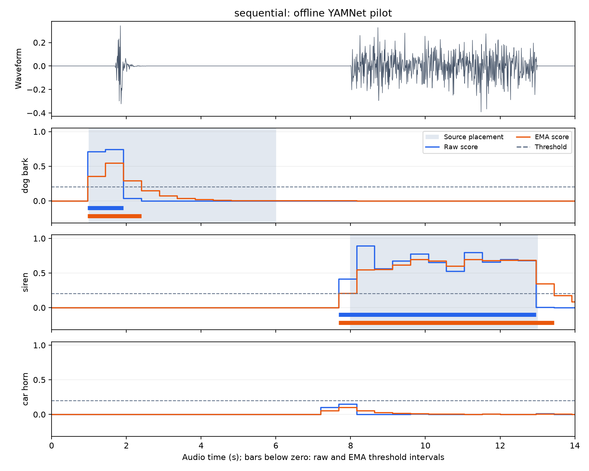
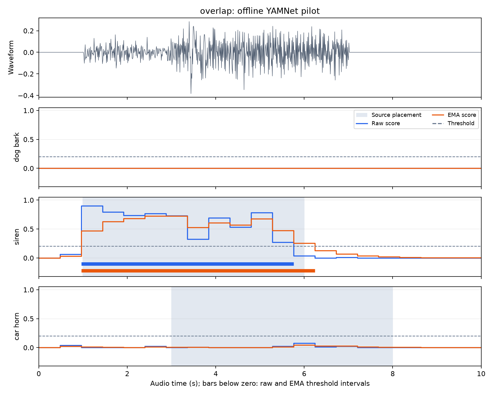

# Initial Implementation and Sliding-Window Pilot

**Mingze Li (Student ID: 550374130) — ELEC5305 Acoustic and Speech Processing**

- [Project Homepage](https://kolentossa.github.io/elec5305-project-550374130/)
- [Final Project Report (PDF)](submission/ELEC5305_Final_Report_Mingze_Li_550374130.pdf)
- [Initial Milestone PDF](submission/ELEC5305_Initial_Implementation_Mingze_Li_550374130.pdf)
- [GitHub Repository](https://github.com/kolentossa/elec5305-project-550374130)

---

## 1. Overview

This report documents the first sliding-window sound event detection (SED) pilot built on top of Rockchip's 3.0 s YAMNet model (`yamnet_3s.onnx` and `yamnet_3s.rknn`). The pipeline processes arbitrary-length WAV recordings on both **Windows ONNX CPU** and **RK3588 NPU (LubanCat-5 V2)**, extracts continuous 0.48 s-hop patch probabilities, and compares raw thresholding against causal exponential moving average (EMA) smoothing.

| Script | Description |
| :--- | :--- |
| [run_yamnet.py](../scripts/run_yamnet.py) | Single 3.0 s window inference and `(6, 521)` patch score extraction |
| [rknn_backend.py](../scripts/rknn_backend.py) | RKNN Lite NPU runtime wrapper for RK3588 (`NPU_CORE_0`) |
| [prepare_pilot_audio.py](../scripts/prepare_pilot_audio.py) | Synthesizes six multi-event audio scenes (16 kHz mono) from ESC-50 fold-4 clips |
| [pilot_detection.py](../scripts/pilot_detection.py) | 2.4 s-step sliding-window inference, thresholding, causal EMA smoothing, and trajectory plotting |
| [evaluate_pilot.py](../scripts/evaluate_pilot.py) | Computes multi-label micro precision and recall across test scenes |
| [plot_pilot_results.py](../scripts/plot_pilot_results.py) | Renders waveform, score, and interval figures from saved NPU and CPU outputs |

---

## 2. Controlled Test Scenes

Three 5.0 s recordings from ESC-50 fold 4 (`dog_bark`: `4-182395-A-0.wav`, `siren`: `4-102871-A-42.wav`, `car_horn`: `4-175845-A-43.wav`) were resampled to 16 kHz and combined into six test scenes (56 s total):

| Scene | Duration | Source Placements | Gain |
| :--- | :---: | :--- | :---: |
| `dog_only` | 8 s | `dog_bark`: 2–7 s | 1.0 |
| `siren_only` | 8 s | `siren`: 2–7 s | 1.0 |
| `horn_only` | 8 s | `car_horn`: 2–7 s | 1.0 |
| `sequential` | 14 s | `dog_bark`: 1–6 s; `siren`: 8–13 s | 1.0 each |
| `overlap` | 10 s | `siren`: 1–6 s; `car_horn`: 3–8 s | 0.5 each |
| `silence` | 8 s | None | — |

---

## 3. Windowing and Temporal Postprocessing

### 3.1 Non-Padded Sliding Window
Each 3.0 s YAMNet call outputs 6 patches spaced by 0.48 s, where each patch covers 96 STFT frames (0.975 s waveform context). Patch index 5 starts at 2.40 s and requires context up to 3.375 s (internally zero-padded by the graph). To avoid internal padding artifacts mid-recording, `infer_scene()` advances the 3.0 s buffer by **2.4 s (38,400 samples)** per step and retains patches 0–4. Across the 56 s pilot set, this produces 119 contiguous patches.

### 3.2 Class Mapping and Temporal Filtering
Target classes are mapped to AudioSet indices in `yamnet_class_map.txt`:
- `dog_bark` -> `Bark` (index `70`)
- `siren` -> `Siren` (index `390`)
- `car_horn` -> `Vehicle horn, car horn, honking` (index `302`)

We compare:
1. **Raw Thresholding:** `p_c(m) >= theta` with `theta = 0.20`.
2. **Causal EMA Smoothing:** `p_ema(m) = alpha * p_c(m) + (1 - alpha) * p_ema(m - 1)` with `alpha = 0.50`, followed by `p_ema(m) >= theta`.

---

## 4. Experimental Results (CPU vs. RK3588 NPU)

Both backends produced identical interval counts and matching interval boundaries across all six scenes:

| Scene | Patches | Raw Intervals | EMA Intervals | Active Detections |
| :--- | :---: | :---: | :---: | :--- |
| `dog_only` | 17 | 1 | 1 | `dog_bark`: 1.92–2.88 s (raw), 1.92–3.36 s (EMA) |
| `siren_only` | 17 | 1 | 1 | `siren`: 1.92–7.20 s (raw), 1.92–7.68 s (EMA) |
| `horn_only` | 17 | 1 | 1 | `car_horn`: 1.44–3.36 s (raw), 1.92–3.84 s (EMA) |
| `sequential` | 30 | 2 | 2 | `dog_bark`: 0.96–1.92 s, `siren`: 7.68–12.96 s (raw) |
| `overlap` | 21 | 1 | 1 | `siren`: 0.96–5.76 s (raw), 0.96–6.24 s (EMA) |
| `silence` | 17 | 0 | 0 | None |



### Overlapping Scene Suppression (`overlap`)
In `overlap`, `siren` and `car_horn` overlap between 3 s and 6 s with gain 0.5 each. While `siren` reaches 0.9004 on NPU (0.8968 on CPU), the `car_horn` peak drops from 0.8765 (`horn_only`) to **0.0777 on NPU** (0.0797 on CPU), failing to cross `theta = 0.20`:



### Scene-Level Precision and Recall

| Backend | Method | TP | FP | FN | Micro Precision | Micro Recall |
| :--- | :--- | :---: | :---: | :---: | :---: | :---: |
| Windows ONNX CPU | Raw (`theta = 0.20`) | 6 | 0 | 1 | 100.0% | 85.7% |
| Windows ONNX CPU | EMA (`alpha = 0.50, theta = 0.20`) | 6 | 0 | 1 | 100.0% | 85.7% |
| RK3588 NPU (FP16) | Raw (`theta = 0.20`) | 6 | 0 | 1 | 100.0% | 85.7% |
| RK3588 NPU (FP16) | EMA (`alpha = 0.50, theta = 0.20`) | 6 | 0 | 1 | 100.0% | 85.7% |

---

## 5. Reproduction

```powershell
.\.venv\Scripts\python.exe scripts/prepare_pilot_audio.py
.\.venv\Scripts\python.exe scripts/pilot_detection.py --output .cache/runs/pilot
.\.venv\Scripts\python.exe scripts/evaluate_pilot.py .cache/runs/pilot
.\.venv\Scripts\python.exe -m unittest discover -s tests -v
```
