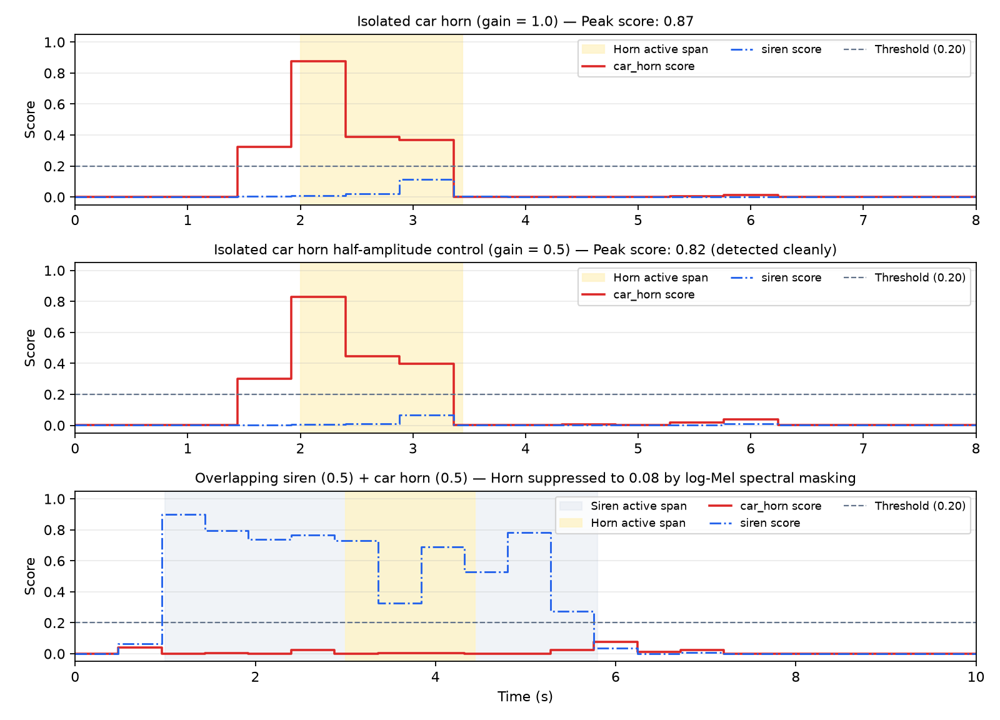
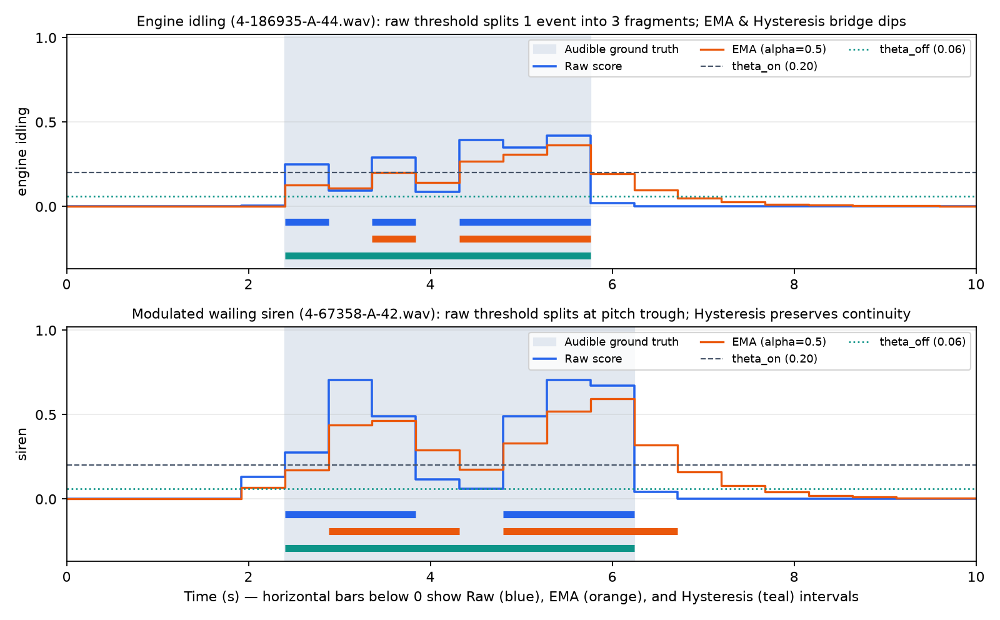
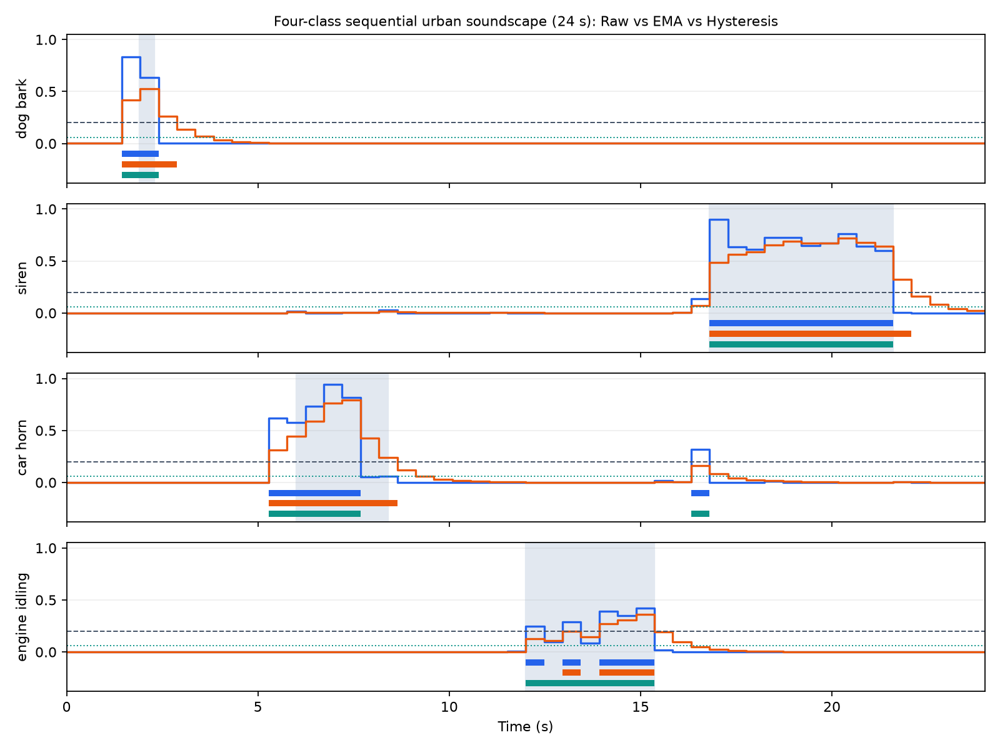

# Temporal Postprocessing, Taxonomy Mapping, and Spectral Masking Study

**Mingze Li (Student ID: 550374130) — ELEC5305 Acoustic and Speech Processing**

- [Project Homepage](https://kolentossa.github.io/elec5305-project-550374130/)
- [Final Project Report (PDF)](submission/ELEC5305_Final_Report_Mingze_Li_550374130.pdf)
- [Full Written Report (Web)](final_report.md)
- [GitHub Repository](https://github.com/kolentossa/elec5305-project-550374130)

---

## 1. Motivation and Experimental Design

Our initial 6-scene pilot revealed three practical challenges when converting short-time YAMNet patch scores (`0.96 s` patch window, `0.48 s` hop) into continuous sound event detections:
1. **Mid-event score fluctuations (Event Fragmentation):** Stationary engines and frequency-modulated sirens exhibit brief score dips across successive `0.48 s` patches, causing raw thresholding to split a single physical sound event into multiple short fragments.
2. **Taxonomy mismatch across urban sound categories:** YAMNet's 521 AudioSet classes do not map uniformly to standard 10-class urban taxonomies (URBAN-SED / UrbanSound8K). Specifically, classes like `engine_idling` distribute probability across `Idling` (index 346) and broader `Engine` nodes (indices 337, 342, 343), whereas `street_music` relies on general `Music` nodes (indices 132, 133).
3. **Overlapping event suppression:** In the pilot `overlap` scene (`siren` + `car_horn` at `0.5` gain each), the `car_horn` score dropped from `0.8765` alone to `0.0777` on the RK3588 NPU. Because amplitude scaling (`1.0` -> `0.5`) and acoustic mixing occurred together, a controlled experiment was required to separate waveform attenuation from spectral masking.

To investigate these three phenomena systematically without tuning on test data, [scripts/temporal_experiments.py](../scripts/temporal_experiments.py) constructs an independent **Validation Split** (5 soundscapes, 56 s, synthesized from ESC-50 Fold 3 recordings) for threshold selection and evaluates on a held-out **Test Split** (12 soundscapes, 122 s, synthesized from ESC-50 Fold 4 recordings with measured audible onset/offset boundaries).

---

## 2. Full 10-Class URBAN-SED to YAMNet Taxonomy Mapping

Implemented in [scripts/class_mapping.py](../scripts/class_mapping.py), all 10 URBAN-SED target categories are mapped to YAMNet's 521 AudioSet indices:

| Target Class | Primary AudioSet Name (Index) | Hierarchical / Subclass Indices | Alignment Type |
| :--- | :--- | :--- | :--- |
| `air_conditioner` | `Air conditioning` (`407`) | `[407]` | Exact 1-to-1 |
| `car_horn` | `Vehicle horn, car horn, honking` (`302`) | `[302, 312]` | Exact + Air horn (`312`) |
| `children_playing` | `Children playing` (`66`) | `[66, 10]` | Exact + Children shouting (`10`) |
| `dog_bark` | `Bark` (`70`) | `[70, 69]` | Exact + Dog (`69`) |
| `drilling` | `Drill` (`419`) | `[419]` | Exact 1-to-1 |
| `engine_idling` | `Idling` (`346`) | `[346, 337, 342, 343]` | Hierarchical (`Idling` + `Engine`) |
| `gun_shot` | `Gunshot, gunfire` (`421`) | `[421, 422]` | Exact + Machine gun (`422`) |
| `jackhammer` | `Jackhammer` (`414`) | `[414]` | Exact 1-to-1 |
| `siren` | `Siren` (`390`) | `[390, 317, 318, 319, 391]` | Exact + Emergency vehicle sirens |
| `street_music` | `Music` (`132`) | `[132, 133, 249]` | Broad proxy (`Music` / `Instrument`) |

### Effect of Hierarchical Aggregation on `engine_idling`
Evaluating the three `engine_idling` test events on the **RK3588 NPU** at threshold `0.20` shows that aggregating across the hierarchical engine nodes (`max` over indices `346, 337, 342, 343`) substantially improves segment recall and reduces fragmentation compared to relying solely on `Idling` (`346`):

| Mapping Strategy (`engine_idling`, RK3588 NPU) | Segment Precision | Segment Recall | Segment F1 | Fragmentation (Intervals / Event) |
| :--- | :---: | :---: | :---: | :---: |
| Single node `Idling` (index `346`) | 100.0% | 66.7% | 0.800 | 2.67 (8 fragments / 3 events) |
| Hierarchical `max(Idling, Engine)` (`[346, 337, 342, 343]`) | 100.0% | 83.3% | **0.909** | **1.33** (4 fragments / 3 events) |

---

## 3. Resolving the Overlapping Horn Failure: Amplitude Control vs. Spectral Masking

To determine why `car_horn` was missed in the mixed scene, we compared four scenes on both Windows CPU and RK3588 NPU:
1. `horn_only`: isolated `car_horn` at `gain = 1.0`
2. `horn_half`: isolated `car_horn` at `gain = 0.5` (`-6 dB` amplitude control, no siren)
3. `overlap_equal`: `siren` (`gain = 0.5`) + `car_horn` (`gain = 0.5`), `0 dB` signal-to-interference ratio (SIR)
4. `overlap_horn_boost`: `siren` (`gain = 0.25`) + `car_horn` (`gain = 0.75`), `+9.5 dB` horn-to-siren ratio

| Scene | Source Gains | Windows CPU Peak `car_horn` | RK3588 NPU Peak `car_horn` | RK3588 NPU Peak `siren` | Detection Outcome (`theta = 0.20`) |
| :--- | :--- | :---: | :---: | :---: | :--- |
| `horn_only` | Horn `1.0` | 0.8728 | 0.8765 | 0.1155 | `car_horn` detected |
| `horn_half` | Horn `0.5` | **0.8175** | **0.8296** | 0.0671 | `car_horn` detected cleanly |
| `overlap_equal` | Siren `0.5` + Horn `0.5` | **0.0797** | **0.0777** | 0.9004 | `siren` only (`car_horn` masked) |
| `overlap_horn_boost` | Siren `0.25` + Horn `0.75` | **0.2630** | **0.2571** | 0.9077 | Both `siren` and `car_horn` detected |

**Signal-Processing Interpretation:** Halving the waveform amplitude (`horn_half`, `gain = 0.5`) reduces the NPU `car_horn` peak only slightly from `0.8765` to `0.8296` because YAMNet's log-Mel frontend applies logarithmic compression `log(Mel + epsilon)`, turning a multiplicative gain factor into a small additive offset. By contrast, when the frequency-modulated `siren` (`500–1800 Hz`) is present simultaneously (`overlap_equal`), its sweeping harmonic energy dominates the shared mid-frequency Mel filterbanks, masking the `car_horn` harmonics and depressing its score to `0.0777`. When the horn-to-siren ratio is increased to `+9.5 dB` (`overlap_horn_boost`), both overlapping classes cross `theta = 0.20` and are detected concurrently.

---

## 4. Temporal Postprocessing Comparison: Stability vs. Detection Delay

Using the Fold-3 validation split, class-specific calibration selected `theta_engine = 0.12` and `theta = 0.20` for `dog_bark`, `siren`, and `car_horn`, while dual-threshold hysteresis selected `theta_on = 0.20` and `theta_off = 0.06`. Below are the held-out Fold-4 test results across all 12 test scenes (16 ground-truth audible events) on **RK3588 NPU** and **Windows CPU**:

### Table 1: RK3588 NPU Test-Set Performance Across Temporal Decision Rules

| Temporal Decision Method | Segment Precision | Segment Recall | Segment F1 | Event F1 | Fragmentation (Intervals / Event) | Mean Onset Delay (s) | Mean Offset Delay (s) |
| :--- | :---: | :---: | :---: | :---: | :---: | :---: | :---: |
| Global Threshold (`theta = 0.30`) | 98.8% | 61.7% | 0.759 | 0.903 | 1.36 | +0.04 s | -0.22 s |
| Global Threshold (`theta = 0.20`) | 99.0% | 72.2% | 0.835 | 0.938 | 1.53 | -0.26 s | -0.12 s |
| Class-Specific Threshold (`theta_c`) | 99.0% | 72.9% | 0.840 | 0.938 | 1.47 | -0.29 s | -0.12 s |
| Causal EMA (`alpha = 0.70`) | 97.0% | 72.2% | 0.828 | 0.938 | 1.33 | -0.10 s | +0.01 s |
| Causal EMA (`alpha = 0.50`) | 95.1% | 72.9% | 0.826 | 0.933 | 1.29 | -0.03 s | +0.29 s |
| Causal EMA (`alpha = 0.30`) | 86.1% | 69.9% | 0.772 | 0.933 | **1.00** | **+0.21 s** | **+0.66 s** |
| **Hysteresis (`theta_on=0.20, theta_off=0.06`)** | **99.0%** | **76.7%** | **0.864** | **0.938** | **1.13** | **-0.26 s** | **-0.09 s** |

### Table 2: Windows ONNX CPU Reference Test-Set Performance

| Temporal Decision Method | Segment Precision | Segment Recall | Segment F1 | Event F1 | Fragmentation (Intervals / Event) | Mean Onset Delay (s) | Mean Offset Delay (s) |
| :--- | :---: | :---: | :---: | :---: | :---: | :---: | :---: |
| Global Threshold (`theta = 0.30`) | 100.0% | 61.8% | 0.768 | 0.933 | 1.43 | +0.08 s | -0.12 s |
| Global Threshold (`theta = 0.20`) | 100.0% | 69.1% | 0.849 | 0.968 | 1.53 | -0.32 s | -0.12 s |
| Class-Specific Threshold (`theta_c`) | 100.0% | 70.9% | 0.853 | 0.968 | 1.47 | -0.35 s | -0.12 s |
| Causal EMA (`alpha = 0.70`) | 95.8% | 73.6% | 0.831 | 0.968 | 1.33 | -0.10 s | +0.01 s |
| Causal EMA (`alpha = 0.50`) | 89.2% | 76.4% | 0.821 | 0.933 | 1.29 | +0.01 s | +0.29 s |
| Causal EMA (`alpha = 0.30`) | 76.4% | 76.4% | 0.763 | 0.933 | **1.00** | **+0.25 s** | **+0.69 s** |
| **Hysteresis (`theta_on=0.20, theta_off=0.06`)** | **100.0%** | **78.2%** | **0.878** | **0.968** | **1.13** | **-0.32 s** | **-0.09 s** |

*(Note: Negative mean onset delay `-0.26 s` reflects discrete quantization to the `0.48 s` patch start when an acoustic onset falls inside the `0.975 s` patch support window.)*

### Key Findings on the Stability–Delay Trade-Off
1. **Raw thresholding suffers from severe fragmentation (`1.53` fragments/event):** In `engine_fluctuating` (`4-186935-A-44.wav`), mid-event score dips (`0.095` and `0.085`) break one continuous 3.36 s engine event into 3 disconnected intervals. In `siren_modulated` (`4-67358-A-42.wav`), a pitch trough splits the wailing siren into 2 intervals.
2. **Causal EMA smoothing reduces fragmentation at the cost of linear group delay:** Decreasing `alpha` from `0.70` -> `0.50` -> `0.30` monotonically reduces fragmentation (`1.33` -> `1.29` -> `1.00`), but increases mean onset delay by `+0.47 s` (from `-0.26 s` to `+0.21 s` on NPU) and increases mean offset delay by **`+0.78 s`** (from `-0.12 s` to `+0.66 s` on NPU), reducing Segment Precision from `99.0%` to `86.1%`.
3. **Dual-threshold hysteresis achieves the best balance (`SegF1 = 0.864` on NPU, `0.878` on CPU):** Because hysteresis triggers immediately at `p_c(m) >= 0.20` and holds state across mid-event dips above `theta_off = 0.06`, it eliminates fragmentation on all isolated and sequential scenes (`1.00` interval/event on `engine_fluctuating`, `siren_modulated`, and `sequential_4class`) without adding the exponential decay tail of EMA (`Offset Delay = -0.09 s`).

---

## 5. RK3588 End-to-End Streaming Latency Breakdown

Across all 87 three-second sliding windows evaluated on the **RK3588 NPU Core 0**, measured execution latencies are:

| Pipeline Stage | Measured Duration | Real-Time Factor (per 2.4 s step) |
| :--- | :---: | :---: |
| Acoustic Patch Context / Hop Stride | 975 ms window / 480 ms stride | Algorithmic time resolution |
| Audio Buffer Slicing (16 kHz PCM float32) | < 0.15 ms | < 0.0001 |
| **RK3588 NPU Inference (`yamnet_3s.rknn`, FP16)** | **20.83 ms mean** (P50: 20.14 ms, P95: 26.79 ms) | **0.00868** (~115x real-time) |
| Temporal Postprocessing (Hysteresis / EMA per window) | < 0.05 ms | < 0.0001 |
| Algorithmic Onset / Offset Decision Delay (Hysteresis) | 0 ms extra patch lag beyond raw threshold | 0 additional patches |
